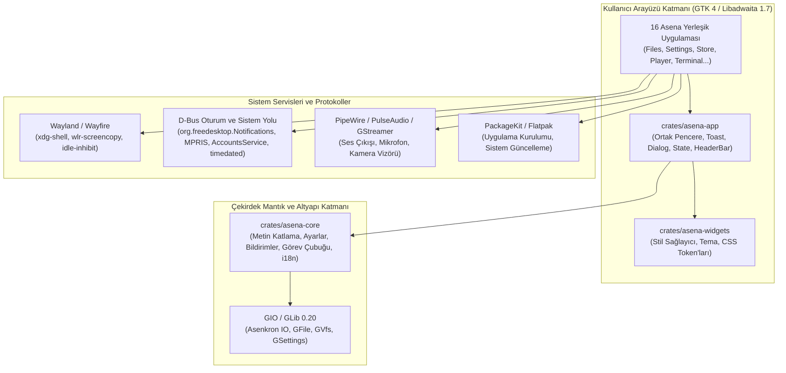

# Asena Uygulama Mimarisi ve Sistem Entegrasyonları (App Architecture)

Asena Desktop ekosistemindeki uygulamaların sistem katmanlarıyla, D-Bus servisleriyle, Wayland protokolleriyle ve donanım altyapısıyla nasıl bütünleştiğini tanımlayan mimari belgedir.

---

## 1. Mimari Katmanlar

### 1.1 Uygulama Katmanı (Binary Crate'ler)
Her uygulama bağımsız bir Rust binary crate'idir (`crates/asena-*`). Tekil uygulama modeli (`adw::Application` / `gio::ApplicationFlags::HANDLES_COMMAND_LINE`) kullanarak çift açılışları önler; mevcut pencereyi öne getirir veya komut satırı argümanlarını (dosya açma, panel seçme) işler.

### 1.2 Ortak Altyapı Katmanı (`asena-app`, `asena-widgets`, `asena-core`)
- **`asena-core`:** GTK ve grafik kütüphanelerine bağımlı olmayan saf Rust veri modelleri, algoritmalar ve D-Bus tipleri (Türkçe arama katlama `text::fold`, GSettings yükleyici `settings::load`, bildirim kuyruğu `notification`, görev çubuğu sıralaması `taskbar`).
- **`asena-widgets`:** GResource yükleyici, global CSS sağlayıcı (`shell.css`, `apps.css`), renk şeması (`adw::StyleManager`) ve yazı tipi ölçekleme yöneticisi.
- **`asena-app`:** Standart pencere oluşturucu, toast kontrolü, empty/loading/error durum sayfaları, standart diyaloglar ve asenkron görev koşturucusu.

---

## 2. Sistem Entegrasyonları ve Standartlar

### 2.1 Wayland ve Wayfire
- Shell ve uygulamalar yalnızca standart Wayland protokolleri (`xdg-shell`, `wlr-layer-shell`, `wlr-screencopy`, `ext-idle-inhibit`) üzerinden konuşur.
- Compositor'e özel hack veya doğrudan compositor iç bellek erişimi yasaktır. 21 Ekim 2026'da labwc'den Wayfire'a geçişte uygulamalarda hiçbir değişiklik gerekmedi; başka bir wlroots compositor'e geçişte de böyle kalmalıdır.

### 2.2 D-Bus Protokolleri ve Servis İsimleri
- **Ayarlar Yolu:** `org.asenalinux.Settings` (`/org/asenalinux/Settings`, `OpenPanel(s)`).
- **Medya Denetimi:** `org.mpris.MediaPlayer2.asena_player` üzerinden parça bilgisi, oynat/duraklat/sonraki ve pozisyon yayını yapılır. Asena panel ve hızlı ayarlar bu arayüzü dinler.
- **Masaüstü Bildirimleri:** `org.freedesktop.Notifications` 1.2 şartnamesi. `asena-shell` sunucu rolünü, uygulamalar istemci rolünü üstlenir.
- **Yetkilendirme:** Sistem ayarlarını değiştirme (saat, dil, kullanıcılar) polkit korumalı standart sistem servisleri (`org.freedesktop.timedate1`, `org.freedesktop.locale1`, `org.freedesktop.Accounts`) üzerinden yapılır. Asena içinde `pkexec` betik çağrısı yasaktır.

### 2.3 Dosya Sistemi ve GVfs
- Dosya yöneticisi (Asena Files) ve Arşiv yöneticisi (Asena Archive), GIO `GFile` ve `GVfs` arka uçlarını kullanır.
- Çöp kutusu işlemleri `trash://` URI şemasıyla standart FreeDesktop Trash spesifikasyonuna uygundur.
- USB bellekler ve ağ paylaşımları (SFTP, SMB) `gio::VolumeMonitor` üzerinden dinamik olarak algılanır ve kenar çubuğuna eklenir.

---

## 3. Performans ve Güvenlik İlkeleri

1. **Ana Thread Asla Bloklanamaz:** Dosya kopyalama, disk tarama, arşiv çıkarma, paket sorgulama ve HTTP istekleri daima `gio::spawn_blocking` veya arka plan thread havuzunda koşturulur; sonuçlar GLib ana döngüsüne (`glib::spawn_future_local`) sinyallerle iletilir.
2. **Panik Yasaktır:** `unwrap()` ve `expect()` test kodları haricinde kesinlikle yasaktır. Kütüphanelerde `thiserror`, binary'lerde `anyhow` ile hata güvenli biçimde yakalanıp arayüzde `AsenaErrorState` veya toast olarak gösterilir.
3. **Bellek Bütçesi:** Hiçbir yardımcı uygulama boştayken 80MB RSS bellek eşiğini aşamaz. Gereksiz kütüphane bağlantılarından ve sızıntılardan kaçınılır.
